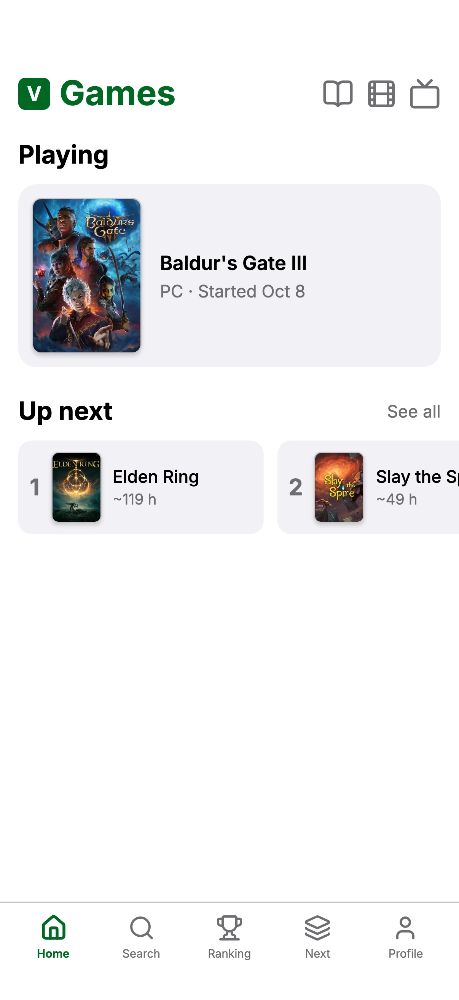
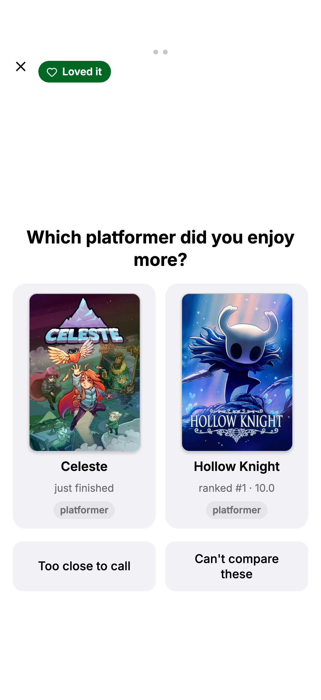
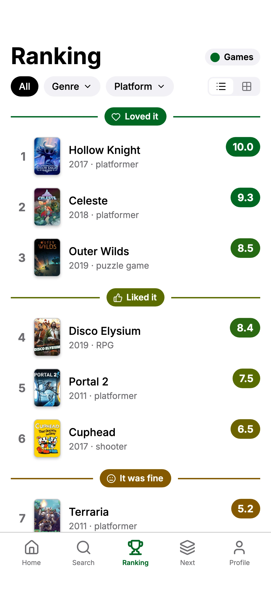

# Verso

In an age of AI, the most valuable resource is human time. An AI can read an entire book with your perspective and see if you would like it, so why not go ahead and do it and maximize your free time? Verso is built on that idea: a recommendation engine across media that learns your taste the most natural way, one pick at a time, by having you place what you played or watched in a ranked list through a few head-to-head comparisons, and then tells you what to spend tonight on and why, with the reason drawn from your own list. Games and movies first; the tracker, the backlog and the social layer are free and are how the engine learns; nothing about you is ever sold.

**Status:** private beta, invite only, through TestFlight on iOS, with Android and the web build from the same codebase; games and movies.

<p align="center">
  
  
  
</p>

*The app's web build at phone size, with a demo library on a local catalog.*

## Start here

Two ways through this repo, by what you came for. Every direction below started as a research report with sources, became a brief with options and a default, was drawn in Figma and reacted to, and was recorded as a dated decision; the documents are those records.

**The product, about ten minutes.**

1. [ROADMAP.md, End state and Principles](ROADMAP.md#end-state): what Verso is for, and the rules every decision is judged against.
2. [docs/design/ranking-algorithm.md](docs/design/ranking-algorithm.md): the options for turning a few "this one or that one?" answers into a ranked list, with a worked example, and the one chosen.
3. [docs/design/onboarding-guidelines.md](docs/design/onboarding-guidelines.md): how a stranger reaches ten ranked items and one convincing pick in one sitting, and what was borrowed and refused from other apps.
4. [docs/design/movies-brief.md](docs/design/movies-brief.md): the same loop designed from a second medium outward, which is the test of the media-agnostic core.
5. [ROADMAP.md, Decisions](ROADMAP.md#decisions): every decision, dated, with the reasoning and the reversals.

**The engineering, about twenty minutes.**

1. [ARCHITECTURE.md](ARCHITECTURE.md): the pieces, how data flows, and why.
2. [packages/core/src/ranking.ts](packages/core/src/ranking.ts): the ranking engine as a pure state machine, and [its tests](packages/core/test/ranking.test.ts).
3. [supabase/migrations](supabase/migrations) and [supabase/tests/rls.test.sql](supabase/tests/rls.test.sql): the schema, Row Level Security on every table, and the pgTAP suite that proves it with two users.
4. [supabase/functions/suggest/index.ts](supabase/functions/suggest/index.ts): the recommender's Edge Function, from the meter to the model call.
5. [docs/process/reviewing-prs.md](docs/process/reviewing-prs.md): how a change gets in.

## The repo

A pnpm monorepo, TypeScript throughout. [ARCHITECTURE.md](ARCHITECTURE.md) is the map of how data flows and why.

```
apps/mobile       the Expo Router app: iOS, Android and the web from one codebase
apps/site         the marketing site, a static Next.js export
apps/holding      the one-page holding site the domain showed first
packages/core     the media-agnostic model and the ranking engine, pure TypeScript
packages/api      the typed data layer over supabase-js and the generated database types
packages/catalog  the IGDB and TMDB mirror and the enrichment jobs that run on a schedule
packages/tokens   design tokens exported from Figma, built into the app's theme
supabase/         migrations, pgTAP suites, four Deno Edge Functions, local config
docs/             design, specs, research, process; docs/README.md is the index
```

## Product decisions

Each links to the document that records it; the dated list is in [ROADMAP.md](ROADMAP.md#decisions).

- **The recommender is the product, and ranking is its sensor.** The head-to-head answer, given after you finish something, is a satisfaction signal no other tracker collects. The tracker, the backlog and the social layer are free and exist to feed the engine. [ROADMAP.md, Principles](ROADMAP.md#principles).
- **Four tiers, then a few comparisons, never star ratings.** A rating asks for a number nobody gives consistently; "which was better?" is answerable, and the result is a list that explains itself as "between X and Y". "Too close" and "can't compare" exist for when the question is unfair. [docs/design/ranking-algorithm.md](docs/design/ranking-algorithm.md).
- **Each medium is its own product, on one loop.** Games and movies share the ranking loop, and everything around it is designed from the medium's own use outward: movies get a watchlist, a calendar of releases and a diary; games get a backlog, playtime and where to play. [docs/design/ui-principles.md](docs/design/ui-principles.md), [docs/design/movies-brief.md](docs/design/movies-brief.md).
- **The first session is the trial.** Onboarding is judged by one test: a stranger reaches ten ranked items and one convincing pick before leaving. So it is a questionnaire of which media to track, then a deck of popular titles tiered in bulk and ranked in one session. [docs/design/onboarding-guidelines.md](docs/design/onboarding-guidelines.md), [docs/design/onboarding-brief.md](docs/design/onboarding-brief.md).
- **Ownership is out.** Verso tracks what you played and what you are thinking of playing, not what you own; the collector features were cut once they started spreading through every screen. [ROADMAP.md, decision 26](ROADMAP.md#decisions).
- **The model explains and never scores.** SQL picks the candidates from your own list; a language model chooses among them and writes the reason in your terms. Neighbor predictions wait until a harness shows them beating that baseline, and a permission step precedes the first pick. [docs/design/recommendation-engine.md](docs/design/recommendation-engine.md).
- **Never sold, free or paid.** No sale or cross-context sharing of personal data on any tier; any data product is aggregate and de-identified. [ROADMAP.md, Principles](ROADMAP.md#principles).

## Engineering decisions

Each choice links to the document that explains it; the dated record of every decision is in [ROADMAP.md](ROADMAP.md#decisions).

- **Ranking is tiers plus binary insertion**, not star ratings or Elo: four tiers, binary-search insertion within a tier, a genre-preferring pivot, "too close" and "can't compare" escape hatches, and a confirm step. Every comparison is stored as an event. [docs/design/ranking-algorithm.md](docs/design/ranking-algorithm.md), from [the Beli research](docs/research/beli-ranking-algorithm.md).
- **The recommender works from one person's list first.** Candidates come from SQL, scored by a community prior and the person's own tiers; a model picks among them and writes the reason, and never scores. Neighbor predictions wait until a harness shows them beating that baseline. [docs/design/recommendation-engine.md](docs/design/recommendation-engine.md), from [the engine research](docs/research/recommendation-engine.md).
- **The data model is media-agnostic.** One set of tables for every medium (items, entries, rankings, comparisons), with game and film specifics in extension tables, so adding films left rankings and comparisons untouched. [ROADMAP.md, Data model](ROADMAP.md#data-model).
- **Supabase is the whole backend**, reached directly from the app: Postgres, Auth, pg_cron and Edge Functions, with Row Level Security on every user table from its first migration and a pgTAP policy test for each. [docs/design/tech-stack.md](docs/design/tech-stack.md), [docs/research/backend-and-hosting.md](docs/research/backend-and-hosting.md).
- **One Expo codebase for three platforms**, mobile first. [docs/research/app-framework.md](docs/research/app-framework.md); the web build is in [docs/design/web-brief.md](docs/design/web-brief.md).
- **IGDB and TMDB are mirrored into Postgres** by scheduled jobs, under each source's terms; the app never calls a catalog API. [docs/research/game-data-sources.md](docs/research/game-data-sources.md), [docs/design/film-tv-catalog.md](docs/design/film-tv-catalog.md), [docs/design/igdb-setup.md](docs/design/igdb-setup.md).
- **Screens are designed in Figma before they are coded**, against one running file of rules. [docs/design/figma-workflow.md](docs/design/figma-workflow.md), [docs/design/ui-principles.md](docs/design/ui-principles.md).

## Run it

Against the local Supabase stack; no hosted project is needed. [docs/process/local-development.md](docs/process/local-development.md) has every step and every script.

```bash
pnpm install
supabase start                                 # Postgres, Auth and the API gateway in Docker; applies the migrations
cp apps/mobile/.env.example apps/mobile/.env   # then set the URL and anon key that `supabase status -o env` prints
pnpm ios                                       # or pnpm web, or pnpm android
```

The catalog starts empty. `pnpm catalog:sync:full` fills it from IGDB with a Twitch application's credentials in `.env` ([docs/design/igdb-setup.md](docs/design/igdb-setup.md)); `pnpm catalog:tmdb-sync:full` adds films and series once a TMDB token is there.

## Testing

| Suite | Runs with | Covers |
|---|---|---|
| vitest, 1,679 tests in 107 files | `pnpm test` | `packages/core` (160: the ranking engine, the batch session, the deck), `packages/catalog` (630: the mappers, the trim rule, every sync command against fixtures), `packages/api` (331: the data layer, live against the local stack, with two-user isolation on every read), `apps/mobile` (558: the screen rules, formatting, navigation, the stores) |
| pgTAP, 25 suites, 1,348 assertions | `pnpm db:test` | The schema, the Row Level Security policies with two users, and every SQL function the app calls |
| Deno, 103 tests | `deno test supabase/functions/<name>` | The four Edge Functions against fixtures with an injected `fetch`; nothing reaches Steam or the model |

CI ([`.github/workflows/ci.yml`](.github/workflows/ci.yml)) runs all of it on every pull request against a fresh local stack, plus the web export, the site build and the token check.

## Credits

- Game data from [IGDB](https://www.igdb.com), through the Twitch API.
- Film and TV data from [TMDB](https://www.themoviedb.org). This product uses the TMDB API but is not endorsed or certified by TMDB. Streaming availability is JustWatch data as TMDB relays it.
- Steam review scores, concurrent player counts and library imports from the [Steam Web API](https://steamcommunity.com/dev) and the storefront. Steam is a trademark of Valve Corporation.
- Critic scores from [OpenCritic](https://opencritic.com), through its official API.
- Cross-linking ids from [Wikidata](https://www.wikidata.org) (CC0).
- Platform glyphs from [Simple Icons](https://simpleicons.org) (CC0); interface icons from [Lucide](https://lucide.dev) (ISC); the typeface is [Inter](https://rsms.me/inter/) (SIL Open Font License).
- Subscription availability from Game Pass, GeForce NOW and [IsThereAnyDeal](https://isthereanydeal.com).

## License

All rights reserved. The code is published to be read, not reused: no license is granted to copy, modify or distribute it. Third-party data and assets stay under their own terms, listed above.

## How it is built

Verso is built by one person with Claude Code: screens are designed in Figma first, the code lands as small pull requests reviewed by diff before they merge, every change runs the pgTAP and vitest suites in CI, and this README was written the same way.
